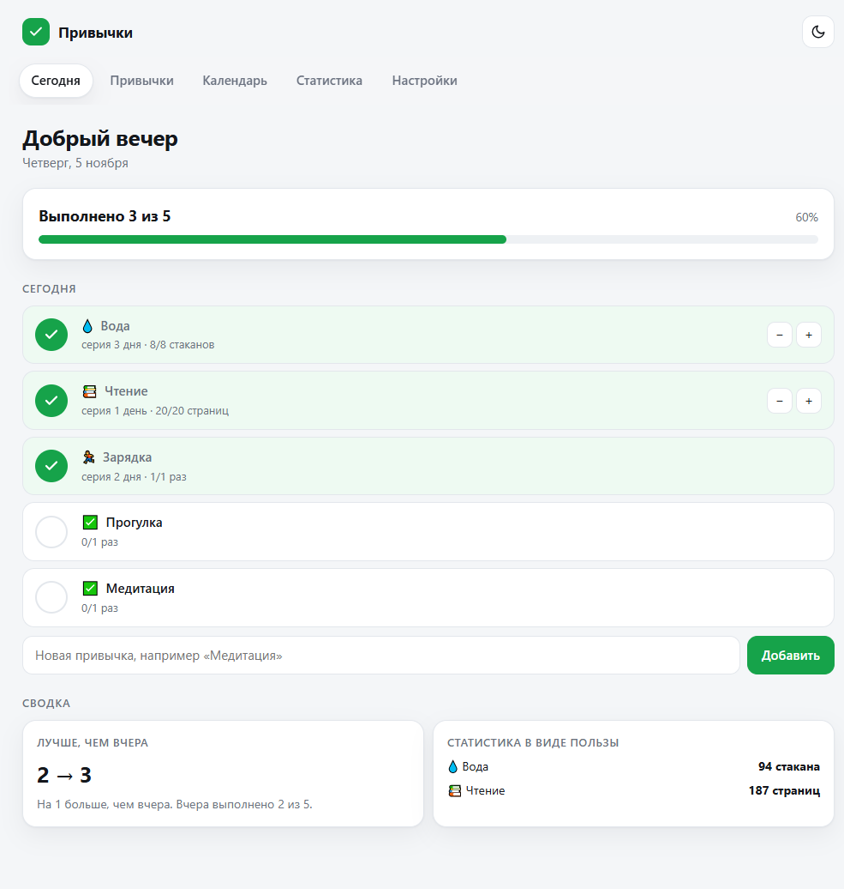
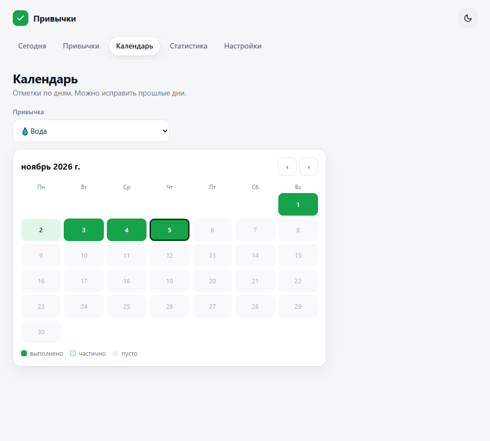
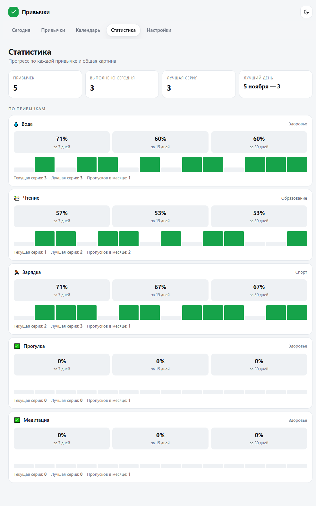
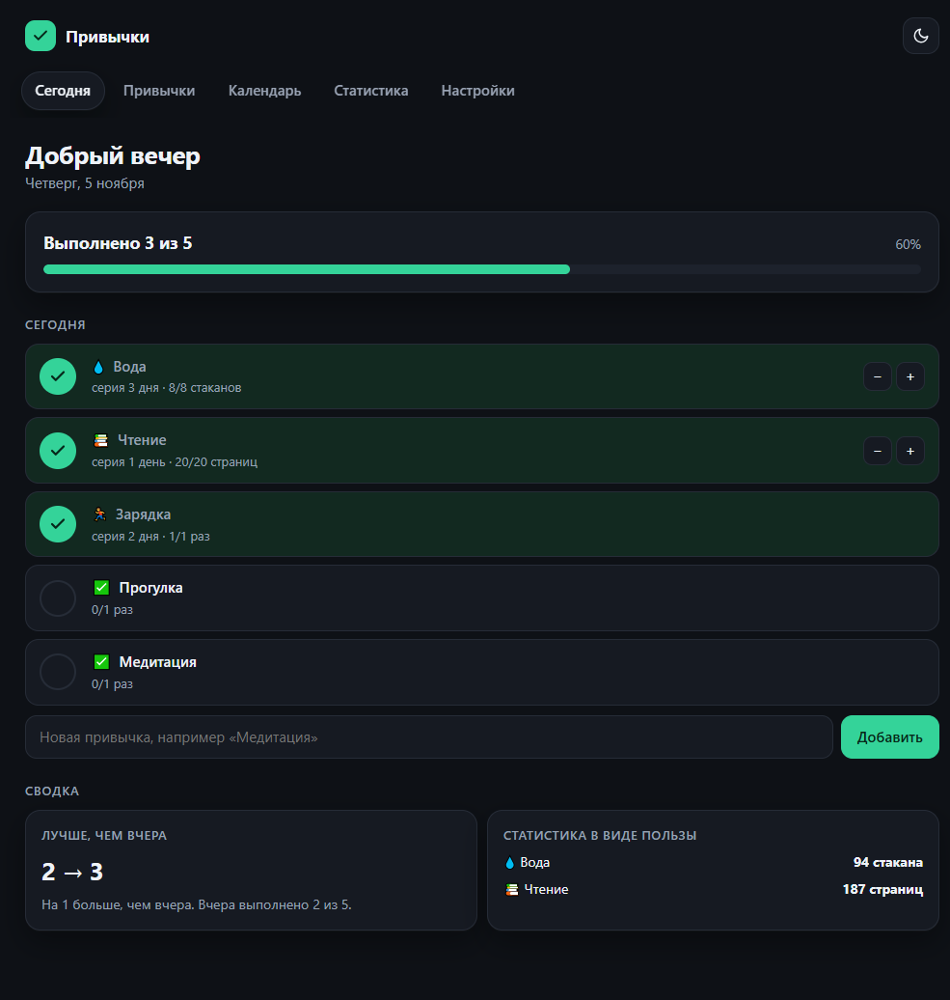
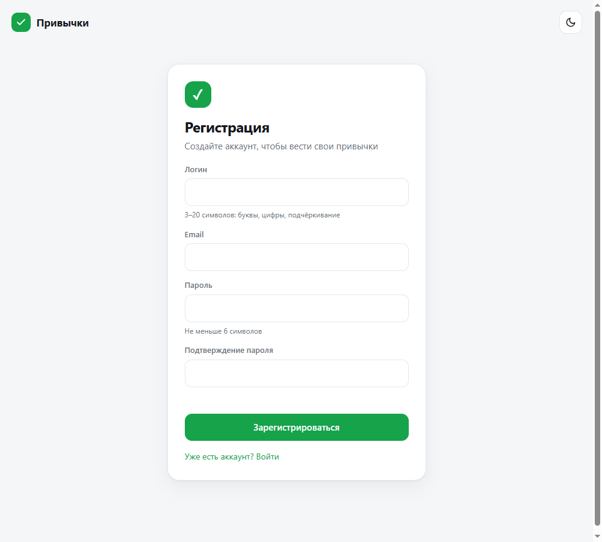
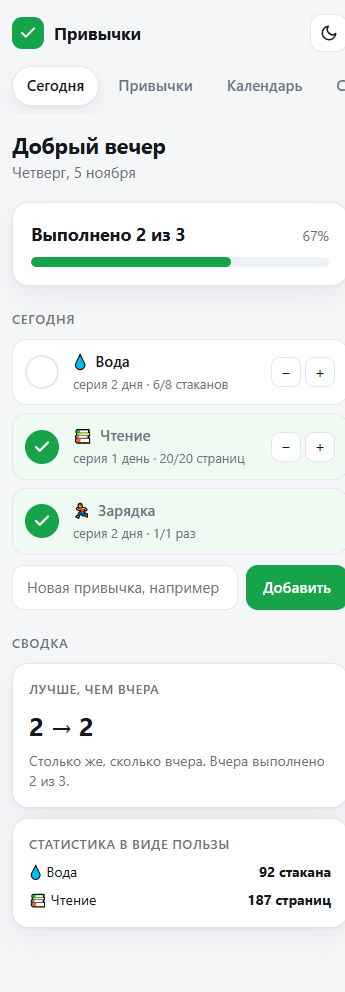

# Трекер привычек

Учебный MVP по кейсу №1 из домашнего задания. Личный трекер привычек без сервера
и регистрации: все данные хранятся в браузере.

## Ссылки

- Приложение: https://fatkullinar-eng.github.io/habit-tracker/
- Код: https://github.com/fatkullinar-eng/habit-tracker

Опубликовано на GitHub Pages. Для публикации используется только статическая часть:
`index.html`, `styles.css`, `app.js`. Файл `server.js` нужен только для локального
запуска.

## Какая задача решается

Человек решает завести привычку — спорт, чтение, вода, — но через неделю бросает,
потому что не видит прогресса. Приложение показывает серию дней, календарь и
статистику: видно, где привычка держится, а где сорвалась. Данные остаются
на устройстве, регистрация нужна только для вида, как в настоящем продукте.

## Для кого

- **Обычный пользователь** — отмечает привычки на сегодня и смотрит прогресс.
- **Тот, кто ведёт несколько привычек** — раскладывает их по категориям и архивирует.
- **Учебный кейс** — показывает работу с датами, хранением данных и темами.

## Стек

- HTML, CSS, JavaScript без фреймворков.
- Данные — в `localStorage`, пароль хранится хешем с солью.
- Публикация — GitHub Pages, локальный запуск — Node.js (`server.js`).

## Скриншоты

| Сегодня | Календарь |
| --- | --- |
|  |  |

| Статистика | Тёмная тема |
| --- | --- |
|  |  |

| Регистрация | Мобильная версия, 360 px |
| --- | --- |
|  |  |

## Что умеет

- отметить привычку на сегодня;
- считать серию и лучшую серию;
- показывать прогресс за 7, 15 и 30 дней;
- вести календарь и исправлять прошлые дни;
- делить привычки по категориям и архивировать;
- переключать светлую и тёмную темы;
- выгружать данные в JSON;
- регистрироваться и входить под своим логином;
- восстанавливать пароль по email (экран-демонстрация);
- показывать страницу 404 для несуществующих адресов.

## Как запустить на компьютере

Нужен Node.js. В папке проекта открой PowerShell и выполни:

```
node server.js
```

Затем открой в браузере:

```
http://localhost:3000
```

Остановить сервер — Ctrl + C в том же окне.

## Как опубликовать на Railway

1. Загрузить папку в репозиторий GitHub.
2. В Railway выбрать «Deploy from GitHub repo».
3. Railway сам увидит `package.json` и выполнит `npm start`.
4. В настройках проекта нажать «Generate Domain» и скопировать ссылку.

Порт берётся из переменной окружения `PORT`, которую Railway подставляет сам.

## Структура

```
habit-tracker/
  index.html    — разметка
  styles.css    — оформление и темы
  app.js        — вся логика
  server.js     — мини-сервер для запуска и публикации
  package.json  — команда запуска
  info/ТЗ.md    — техническое задание
  info/screenshots/ — снимки первого запуска и финальной версии
```

## Вход и аккаунт

При первом запуске приложение предлагает зарегистрироваться: логин, email, пароль.
Пароль не хранится в открытом виде — сохраняется его хеш с солью.

Важно: это демонстрационный вход. Аккаунт и данные лежат в браузере пользователя,
сервера нет. Восстановление пароля показывает экран с инструкцией, но письма
не отправляются. Для реального клиента нужен сервер, база данных и настоящая
авторизация — это следующий этап.

Адреса разделов: `#/today`, `#/habits`, `#/calendar`, `#/stats`, `#/settings`.
Неизвестный адрес открывает страницу 404.

## Ограничения MVP

Данные живут только в том браузере, где открыто приложение. При очистке данных
браузера они исчезнут. Для клиента следующий шаг — сервер и база.
